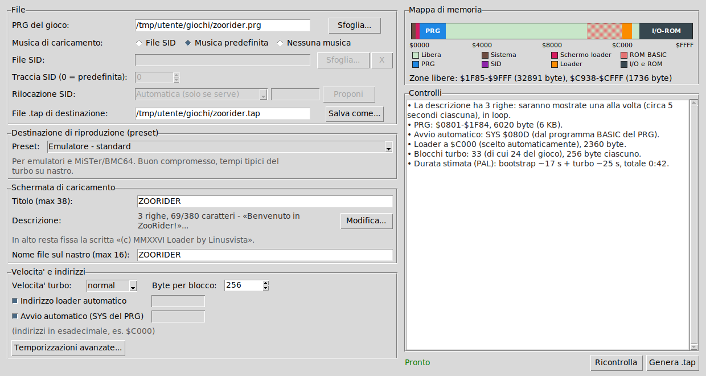

# C64 TAP Builder

**Crea un file `.tap` per Commodore 64 con turbo loader, schermata di caricamento animata, musica SID e il tuo programma.**

*[English version](README.en.md)*



Dai in pasto a C64 TAP Builder un file `.prg` (il tuo gioco o programma) e ottieni un'immagine nastro `.tap` che si carica
molto più in fretta del normale, mostrando una schermata di caricamento con titolo arcobaleno, barra di avanzamento,
testo scorrevole a pagine e musica. Funziona da interfaccia grafica o da riga di comando.

## Caratteristiche

- **Turbo loader** in linguaggio macchina 6502, guidato da interrupt (pin FLAG del CIA1): la CPU resta libera per
  musica e grafica mentre i dati arrivano dal nastro. Ogni blocco ha il suo checksum.
- **Schermata di caricamento**: titolo arcobaleno animato, barra di avanzamento con percentuale, bordo che lampeggia
  in sincronia con i dati, scritta fissa in alto e fino a 10 righe di descrizione (38 caratteri ciascuna) mostrate una alla volta.
- **Musica a scelta**: file `.sid` (PSID), musica predefinita inclusa oppure nessuna musica.
- **Rilocazione automatica del SID**: se la tune si sovrappone al tuo programma viene spostata in una zona libera
  e il risultato viene verificato con un emulatore 6502 incorporato. Un pulsante propone l'indirizzo ideale.
- **Controlli prima di generare**: riconosce file sbagliati (D64, T64, SID al posto del PRG...), conflitti di memoria,
  testi troppo lunghi o con caratteri non disponibili. Il programma non genera il nastro finché ci sono errori.
- **Preset** per emulatore (veloce / standard) e per datassette originale (normale / sicuro).
- **Mappa di memoria** colorata che mostra dove stanno PRG, SID, loader e le zone libere.
- **Nessuna dipendenza esterna**: solo Python (e `tkinter` per la grafica). Contiene anche un mini-assembler 6502.

## Requisiti

- Python 3.8 o successivo (sviluppato e provato con Python 3.12)
- Per l'interfaccia grafica: `tkinter`
  - Debian/Ubuntu: `sudo apt install python3-tk`
  - Fedora: `sudo dnf install python3-tkinter`
- Pensato per **Linux**. Dovrebbe funzionare anche su Windows e macOS (Python + tkinter), ma non è stato provato.

## Installazione

Non serve installare nulla: scarica `c64tap.py` (o clona il repository) ed eseguilo.

```bash
git clone https://github.com/linusvista/c64tapbuilder.git
cd c64tapbuilder
python3 c64tap.py
```

## Uso con l'interfaccia grafica

Avvia `python3 c64tap.py` senza argomenti.

1. Scegli il **PRG** del gioco. Il nome del `.tap` di destinazione viene proposto da solo.
2. Scegli la **musica**: *File SID*, *Musica predefinita* o *Nessuna musica*. Con un SID puoi scegliere la traccia e la
   rilocazione (*Automatica*, *Nessuna*, *Manuale* con il pulsante **Proponi** per l'indirizzo ideale).
3. Scegli il **preset** (emulatore o datassette).
4. Scrivi il **titolo** e, con **Modifica...**, la descrizione: fino a 10 caselle da 38 caratteri. Le caselle vuote
   vengono ignorate; le altre compaiono una alla volta (circa 5 secondi ciascuna) in loop.
5. Controlla il riquadro **Controlli**: errori in rosso, avvisi in arancione, informazioni in nero.
6. Quando compare "Pronto", premi **Genera .tap**.

Le impostazioni di titolo, descrizione, nome, musica e preset vengono ricordate in `~/.config/c64tap_gui.json`.

## Uso da riga di comando

```bash
# il caso più semplice
python3 c64tap.py gioco.prg

# con titolo, descrizione a righe separate da "|" e preset per emulatore veloce
python3 c64tap.py gioco.prg -o gioco.tap --preset emu-fast \
    --title "MIO GIOCO" --subtitle "Benvenuto!|Premi play e divertiti"

# con musica SID, traccia 2, rilocata automaticamente se serve
python3 c64tap.py gioco.prg --sid musica.sid --song 2 --sid-reloc auto

# solo controlli, senza scrivere il file
python3 c64tap.py gioco.prg --sid musica.sid --check
```

| Opzione | Significato |
|---|---|
| `prg` | file PRG del programma (senza argomenti si apre la GUI) |
| `-o`, `--output` | file `.tap` di uscita (predefinito: nome del PRG + `.tap`) |
| `--preset` | `emu-fast`, `emu`, `tape`, `tape-safe` (vedi sotto) |
| `--music` | `sid`, `default` o `none` (se c'è `--sid` e manca `--music`, usa il SID) |
| `--sid`, `--song` | file SID (PSID) e numero di traccia |
| `--sid-reloc` | `none`, `auto` (predefinito: sposta solo se serve) oppure un indirizzo, es. `$C800` |
| `--title`, `--subtitle` | titolo (max 38) e descrizione (max 380 caratteri; righe separate da `\|`) |
| `--name` | nome del primo file sul nastro (max 16 caratteri) |
| `--speed` | `slow`, `normal`, `fast` |
| `--chunk` | byte per blocco turbo (16-256) |
| `--run` | indirizzo di avvio, se il PRG non parte con un `SYS` |
| `--loader-addr` | indirizzo del loader residente (predefinito: automatico) |
| `--check` | esegue solo i controlli |
| `--gui` / `--version` | apre la GUI / mostra la versione |

## Preset

| Preset | Velocità | Blocchi | Per |
|---|---|---|---|
| `emu-fast` Emulatore - veloce | fast | 256 | VICE e simili, massima velocità (non per datassette vero) |
| `emu` Emulatore - standard | normal | 256 | emulatori, MiSTer, BMC64; il consigliato |
| `tape` Datassette originale - normale | normal | 256 | datassette in buone condizioni, pilota più lungo |
| `tape-safe` Datassette originale - sicuro | slow | 128 | datassette vecchi o registrazioni su cassetta: lento ma tollerante |

La velocità `normal` trasferisce circa 375 byte al secondo (a titolo di confronto, il KERNAL standard arriva a una
quarantina di byte al secondo effettivi). Una finestra "Temporizzazioni avanzate" permette di cambiare la durata dei toni
pilota e delle pause se un caricamento da nastro vero si blocca.

## Come usare il `.tap`

**Emulatore (VICE):** collega il file come immagine nastro e avvia il caricamento con `LOAD` e il tasto Play del
datassette virtuale (o con l'avvio automatico). Il turbo loader legge gli impulsi veri del nastro, quindi nelle
impostazioni delle periferiche di VICE bisogna **disattivare i "virtual device traps"** del datassette: con le
scorciatoie attive VICE carica solo il primo file e salta la parte turbo.

**Commodore 64 vero:** serve portare il `.tap` su un supporto che il datassette possa leggere (per esempio convertendolo
in un file audio WAV e registrandolo su cassetta, oppure con un dispositivo che emula il datassette come il TAPuino).
Sulla macchina: `LOAD` + Invio, poi Play (oppure `SHIFT + RUN/STOP`). Per i primi tentativi usa il preset
*Datassette originale - sicuro*.

## Come funziona

Il nastro contiene, in ordine:

1. **Stage 1** - un normale file BASIC del KERNAL (`10 SYS 2061`), caricato a velocità standard. Contiene solo il
   ricevitore turbo (circa 600 byte). Lo copia in memoria alta e lo avvia.
2. **Stage 2** - caricato dal ricevitore turbo: schermata di caricamento, driver musicale e dati di scena.
3. **Musica SID** (se scelta) e **programma**: divisi in blocchi, ciascuno con pilota, marcatore, indirizzo,
   lunghezza e checksum XOR. Gli impulsi hanno due lunghezze (bit 0 e bit 1) diverse da quelle del KERNAL; la
   lunghezza di ogni impulso è misurata con il timer B del CIA1.

A fine caricamento il loader ripristina lo stato del sistema (`IOINIT`, `RESTOR`, `CINT`) e avvia il programma con il suo
`SYS`, con `RUN` oppure all'indirizzo indicato.

Mappa di memoria:

- il loader residente (circa 1,4-2,4 KB) sta a `$C000` oppure, se occupato, nella prima zona libera;
- la schermata usa `$0400-$07FF`: il PRG non può occupare quella zona;
- il PRG deve stare tra `$0200` e `$CFFF`, con al massimo 255 blocchi (la dimensione dei blocchi si adatta da sola);
- il loader usa 32 byte di zero page (`$E0-$FF` di norma, spostati altrove se il SID li usa).

## Note sul SID

- Sono supportati i file **PSID** con indirizzo di *play* diverso da zero. Gli RSID e le tune pilotate da IRQ proprio
  non sono supportati.
- La rilocazione avviene a pagine intere (stesso byte basso dell'indirizzo). Il programma esegue la tune nell'emulatore
  finché i riferimenti trovati smettono di aumentare (da 1 a 8 minuti di musica simulata), poi verifica che la tune
  spostata produca esattamente le stesse scritture sul SID e non legga né scriva più nella zona originale. Include anche
  la memoria di lavoro che la tune usa oltre i byte del file.
- È una verifica pratica, non una dimostrazione: parti di codice che la tune non esegue durante l'analisi non vengono
  controllate. Se la rilocazione automatica non riesce, viene rifiutata con una spiegazione: in quel caso usa un SID già
  rilocato (per esempio con `sidreloc`) o la musica predefinita.

## Limiti noti

- Provato con **VICE**. Non ancora provato su un datassette vero né su NTSC (le stime di durata sono per PAL).
- Le lunghezze dei toni pilota del bootstrap standard sono scelte con prudenza ma non verificate su hardware reale.
- Non si possono caricare programmi che occupano memoria sopra `$CFFF` (I/O e ROM) né il tratto `$0400-$07FF`.
- Musiche con campioni digitali o con timing a CIA non sono suonate correttamente (il loader chiama la routine di *play*
  una volta per fotogramma).

## Se qualcosa non va

- **"ERRORE DI CARICAMENTO"** sulla schermata: la riga sotto mostra `BLOCCHI xx/yy ERR zz` (blocchi ricevuti, attesi ed
  errori contati, in esadecimale). Prova un preset più lento. Se succede in emulatore, controlla i "virtual device traps".
- **Il caricamento da nastro vero si blocca**: usa *Datassette originale - sicuro* e, se serve, allunga i toni pilota
  nelle "Temporizzazioni avanzate". Pulisci la testina e regola l'azimut del datassette.
- **La musica si ferma durante il caricamento**: probabilmente la tune usa memoria che il gioco sovrascrive. Lascia la
  rilocazione su *Automatica* o usa **Proponi**.
- **Nessun errore ma schermo nero a fine caricamento**: controlla l'indirizzo di avvio (opzione *Avvio automatico* / `--run`).

## Esempio incluso

In `examples/` trovi `demo.prg` (un programma minimo che stampa un messaggio) e il corrispondente `demo.tap`, così puoi provare
subito il risultato in un emulatore:

```bash
python3 c64tap.py examples/demo.prg -o demo.tap --preset emu
```

## Contribuire

Segnalazioni e proposte sono benvenute tramite le *Issues* del repository. Se segnali un problema di caricamento indica
la versione di Python, l'emulatore (o il datassette) usato, il preset scelto e, se compare, la riga
`BLOCCHI xx/yy ERR zz`. Non allegare file protetti da copyright (giochi, tune SID) di cui non hai i diritti.

## Crediti

Idea e collaudo: Linusvista. Sviluppato con l'assistenza di Claude (Anthropic).

## Licenza

Rilasciato con licenza [MIT](LICENSE). I file `.prg` e `.sid` che usi con questo programma restano di proprietà dei
rispettivi autori: il repository non ne contiene. *Commodore 64* è un marchio dei rispettivi titolari; questo progetto
non è affiliato né approvato da essi.
